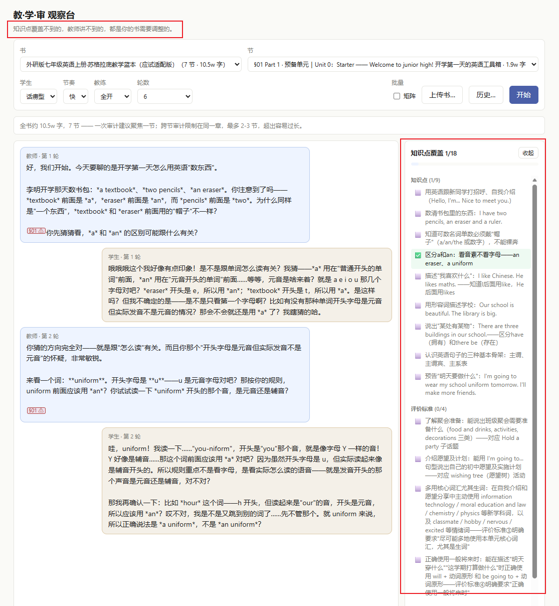

# [socratic-lens](https://github.com/xx-hub/socratic-lens)— 教·学·审 多 Agent 试验台

> 本项目是[Socratopia](https://www.socratopia.app/zh) 的衍生项目，是帮助各位对自己利用AI造的书进行审计的。
>
> Socratopia——苏格拉底式情境学习系统，苏格拉底教学法有着举世公认的奇效，但它始终无法推广，因为它要求一对一教学。没有哪个课堂，能为每一个学生持续提供这样的环境。但 AI 可以。
>
> 当前系统内置了AI为  **七年级上册·教研版** 学生开发的英语书，开箱即测。

## 推荐

本项目是 Socratopia 的衍生项目———用来把你造的书放在工具上跑审计，看看书写得怎么样、讲得怎么样，方便你再去调整你的书，让你造书时的想法切实的得到实现。并且得到一次直观的感受。

对于自己造的书，开发者推荐大家使用 Scotopia 官方学习工具：[Socratopia — AI-Powered Socratic Learning](https://www.socratopia.app/zh)。

[Socratopia](https://www.socratopia.app/zh)能做什么：

- **AI 教师一对一苏格拉底式讲课**——上传你的书，AI 教师逐节讲解，学生在AI老师的引导下学习，老师依靠大模型能力可以解决传统学习过程中老师备课不足的问题，也可以解决学生对任一知识点反复学不会造成的教学时间过长的问题。
- **多种课堂风格**——从对基础弱的同学细致的讲解到对学霸同学快速的预、复习，教学风格根据学生的需要调整
- **多种教师风格**——从话痨型唐僧教师到活泼开朗的大师兄型教师，只有你想不到，没有[Socratopia](https://www.socratopia.app/zh)做不到的。

输入邀请码：SCR-FEJXMQ

· 免费用户 → 立即获得 100万 Token

· 坐馆订阅用户 → 获得 1 书币（价值 $3.99）

***

## 快速开始

```bash
npm install                     # 安装依赖（首次必须）
cp .env.example .env.local      # 创建配置，填入你的 API key
npx next dev                    # 启动 → http://localhost:3000
```

`.env.local` 最小配置（支持任意 OpenAI 兼容端点）：

```env
LLM_BASE_URL=https://api.deepseek.com
LLM_API_KEY=sk-xxx
LLM_MODEL=deepseek-v4-flash
```

## 功能概览

### 上传书

顶栏「上传书…」→ 选 `.md` 文件或粘贴 markdown → 预览切节 → 导入。按 `## 导论 / 第X章 / 第X节` 自动切。

### 跑教学

选书 → 选节 → 选学生画像 → 开始。实时 SSE 流输出。学生看不到原文，只能从教师的话里学。

三种学生画像：`passive`（冷淡）、`moderate`（适度）、`active`（话痨）。

支持矩阵式跑，以三种教学风格叠加三种学生画像，共九种课堂一键测试。

### 审计

会话跑完后，审计面板勾选会话 → 选维度 → 运行。支持跨会话合审。

四个维度：`book`（审书）、`teacher`（审教学）、`fidelity`（保真度勾稽）、`coverage`（覆盖度勾稽）。

总的来说，知识点覆盖不到的、教师讲不到的，都是你的书需要调整的。

## 界面大概长这样：



其他功能正在开发中，需要自备大模型的key。

***

MIT
