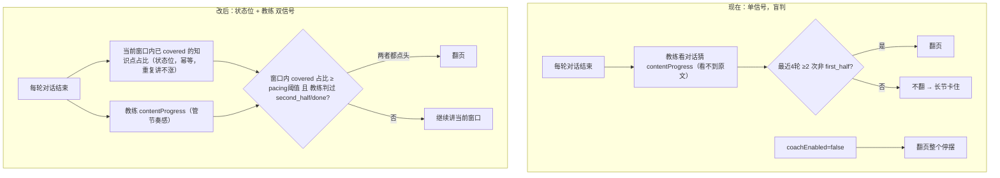

# 动态阅读窗口翻页优化 · 设计草图

> 状态：**方案待审，未改任何代码**。这份文档是给你看的草图，不是成品。
> 觉得方案对 → 让我照着改代码；觉得哪里不对 → 直接在这份文件上划出来，我改文档，代码一行不动。

---

## 一、这套东西在干嘛（一句话）

一节可能几万字，LLM 一次读不下。程序把长的一节切成一页页（约 1800 字/页），教师每次只"看"其中几页，这叫**窗口**。教师把眼前这几页讲完，程序把窗口往后挪，喂他下几页。这就是"动态阅读窗口"。

相关代码：
- 切页 / 滑窗算法：`lib/pagination.ts`
- 拼窗口进教师 prompt：`lib/teacher.ts`（`buildTeacherSystemPrompt`）
- 触发翻页：`lib/session.ts`（约 786–823 行，`自适应翻页` 段）
- 判进度的教练：`lib/coach.ts` + `prompts/coach_rules.md`（`contentProgress` 字段）

---

## 二、现在怎么翻页，为什么长节会卡

每轮对话结束后，后台"教练 AI"看一眼师生对话，输出一句 `contentProgress`：
`first_half`（还在讲这几页的前半）/ `second_half`（讲到后半了）/ `done`（讲完了）。

`lib/session.ts` 把最近 4 轮的判断攒起来，只要有 ≥2 次不是 `first_half`，就翻页。

**问题：这个教练看不到教师正在读的原文。** `prompts/coach_rules.md` 里明确写着"不给你原文，你不需要"。所以它只能靠"听师生聊天"来猜"讲到第几页了"——像让一个没看过课本的人，光听对话去猜老师翻到哪一页。

后果：
1. 教练很容易一直判 `first_half`（`lib/coach.ts` 里默认值也是 `first_half`），长节**翻不动**，教师被困在开头几页反复讲。
2. 翻页还被 `coachEnabled` 绑死（`lib/session.ts:789`）。教练一关，翻页整个停摆——可翻页本是给教师喂新原文的机制，不该跟教练一起关。

---

## 三、两个把方案逼到定稿的坑

这一版方案是被你两个追问逼出来的，先把坑讲清楚，方案才站得住。

### 坑 A：前后重复的知识点，归页有歧义

同一条原句可能在一节里出现两次（前后呼应，很常见）：

```
第 2 页：讲"一般现在时"
第 8 页：又提到"一般现在时"
```

> 说明：这里的"页"不是书上的印刷页码，是程序 `paginate()` 把一节按约 1800 字切出的**块**，第 1 块=第 1 页，纯内部编号。

我上一版说"归最早那页"，想把重复点摁死在一个页上。

### 坑 B（你点破的关键）：覆盖度分不清"讲新点"和"重复讲老点"

覆盖度是靠**匹配教师说的话**来记覆盖的。教师在第 2 页讲过某点，过几轮学生又问、教师又讲一遍——如果拿"覆盖率涨了没"驱动翻页，这第二次重复讲会让覆盖率又跳一下，甚至把页往后推。**可教师明明在原地打转，没往前走。**

结论：**"覆盖率涨没涨"这个信号，天生擅长回答"讲全了没"，不擅长回答"往前走了没"。** 拿它当翻页驱动，方向是拧的。所以这一版换一个不会被"重复讲"污染的口径。

---

## 四、定稿方案：用"覆盖状态位"而不是"覆盖率变化"驱动

### 4.1 核心：一次性状态位，天然幂等

`coverage-tracker` 里每个知识点的 `covered` 是个**一次性状态位**——一旦标记 `covered`，教师再讲第二次也不会产生新变化（代码里 `if (item.status === "covered") return item;` 直接跳过）。

翻页判据因此改成看**状态**、不看**变化**：

> 当前窗口 `[startPage, endPage]` 里、能定位到页的知识点，其中已 `covered` 的**占比 ≥ 阈值**，就认为这几页讲到位了。阈值不是写死的，按 pacing 档位取（见 4.5）。

教师重复讲第 2 页的老点 → 那点早就 `covered` → 占比不变 → **不推页**。只有当窗口里**还没讲过的新点**被讲到、占比真正爬过阈值，才可能翻。"讲全了"和"往前走了"就重新对齐了。

### 4.2 归页：允许一条知识点归属多页（坑 A 的解）

不再纠结"重复点归唯一一页"。一条原句在第 2、第 8 页都出现，就让它**同时算作第 2 页和第 8 页的成员**：

- 教师在第 2 页窗口讲它时，它作为第 2 页成员被记 `covered`。
- 窗口滑到第 8 页时，它作为第 8 页成员**已经是 covered**，不需要教师再讲一遍，占比照算。

因为判据是"这一页的点讲到位没"，多页归属是合理的：那句话本来就在这两处都承担教学内容。坑 A 自然消解。

### 4.3 双信号确认（保险）

翻页需要**两个信号都点头**：

```
翻页 = (当前窗口已 covered 占比 ≥ pacing 阈值)  且  (教练最近判过 second_half / done)
```

- 覆盖状态信号：零 AI 成本，来自已有的 `coverage-tracker`，且幂等。
- 教练信号：原来那套，管"节奏感"（学生消化没、是否在收尾）。
- 任一路偶尔抽风，都不会单独把页翻飞。

### 4.4 覆盖度只驱动"讲全没"，不再驱动"往前走"

`coverage-tracker` 的**覆盖率数字继续只用于展示**（进度条、审计报告）。翻页只吃上面的"状态位占比"，两者解耦。

> 若本节没有知识点清单（`coverage` 未启用），退回现在的纯教练逻辑，不影响老行为。

### 4.5 阈值挂到 pacing（不是全局写死）——回应"自动流程无人踩刹车"

这个项目是**无人值守的自动审书**：教师和学生都是 AI，没有真人喊"下一页"或"下课"。所以"翻早了 = 漏审"是真实风险——尤其教师啃不动、绕过去的那 20%，恰恰是最该被审计记下的线索，不能靠翻页跳过。

但这件事**不需要新概念**：`thorough / normal / express` 这套 pacing 档位，本来就是"审细还是审粗"的旋钮，且已经贯穿教师 prompt、教练、coveage 审计判据三处。翻页松紧直接挂上去即可：

| pacing | 翻页覆盖阈值 | 语义 |
|---|---|---|
| `thorough` | `0.95`（近全覆盖才翻） | 审得细、宁可多跑几轮，对上"这本书到底有没有坑" |
| `normal` | `0.8`（默认） | 讲到主体就走 |
| `express` | `0.6`（主干讲到就翻） | 审得快、控成本，对上批量矩阵 |

这样"翻早漏审 vs 快速过一遍"由用户选 pacing 自己决定，和教师讲课的粗细是**同一个旋钮**，语义一致、无需学新东西。数值先给初值，跑几本书后再调。

---

## 五、现在 vs 改后（对比图）



---

## 六、具体要改哪些文件（供你逐条对照）

> 都是加法为主，尽量不动现有函数签名。

### 6.1 `lib/pagination.ts`
- 新增一个纯函数：给定 `pages` 和某个清单项的 `sourceQuote`，返回它落在第几页（在各页文本里做一次归一化包含匹配，命中即该页）。
- 顺手修掉一个死代码：`initialWindow`（第 99 行）已写好但从没被调用，初始窗口目前写死"前 4 页"（`lib/teacher.ts:70`），可改成用 `initialWindow` 按字符预算算。

### 6.2 `lib/coverage-tracker.ts`
- 给 `CoverageItem` 加一个 `pages?: number[]`（该知识点在原文**哪几页**出现，允许多页——见 4.2）。初始化时用 `fuzzyKey` 逐页匹配算出，定位不到就留空数组。
- 新增纯函数 `windowCoveredRatio(items, startPage, endPage)`：只看 `pages` 与 `[startPage, endPage]` 有交集**且已定位**的项，返回其中 `status === "covered"` 的占比；分母（可定位项数）一并返回，供降级判断。

### 6.2.1 归页管理（新方案的命门，单列）
- 清单本身**不写页号**、生成流程**完全不动**（见第九节）。页归属是运行时派生的只读信息。
- 复用 `coverage-tracker` 现有的 `fuzzyKey()` 双向子串模糊匹配，而不是精确匹配——因为实测 `sourceQuote` 常是 LLM 归纳句，未必逐字落在正文（见第九节例子）。
- 一条知识点可归多页（4.2）。定位不到任何页 → `pages = []`，排除出翻页判断，但仍参与展示与审计。

### 6.3 `lib/session.ts`（翻页那段，约 786–823 行）
- 触发条件改成"窗口内 covered 占比 ≥ pacing 阈值 且 教练判过 second_half/done"（阈值查 4.5 的表）。
- 从 `coachEnabled` 解耦：本节被分页 + 有清单，即使教练关着，也能靠状态位占比这一路推进（此时缺教练信号，退化为单信号，允许翻）。
- 没有清单时，保留现在的纯教练逻辑（向后兼容）。
- 降级：若当前窗口**可定位知识点 < 2 条**（分母太小、抖动大），本窗口不信占比，交给教练信号兜。

### 6.4 `prompts/coach_rules.md`
- 不强制改。`contentProgress` 继续当"节奏感"这一路信号用。

### 6.5 阈值（先给个初值，之后按跑的书调）
- 窗口内 covered 占比阈值：**按 pacing 取**——`thorough 0.95 / normal 0.8 / express 0.6`（见 4.5）。
- 窗口可定位知识点下限：`2` 条以下不单独信占比。
- 教练累计触发：沿用现在的"最近 4 轮 ≥2 次非 first_half"。

---

## 七、这次不做的

- 手动跳页（参考项目的 `/api/jump-page`）：你的 section 本身就是教学单元，跳页需求弱，先不碰。
- token 预算替代字符预算（CJK=1 / 其它=0.25 的粗估）：纯中文书没差，中英混排才有意义，等确有需要再说。
- auto-stop 在"不分页 + 关教练"组合下只能靠跑满 200 轮兜底：已知边界，本轮不处理，单列一个 TODO。

---

## 八、决策记录（已拍板）

1. 口径：不用"覆盖率变化"，改用"窗口内 covered **状态位**占比"驱动，重复讲不推页。✅
2. 归页：一条知识点允许归多页，定位不到就排除。✅
3. 阈值：窗口内 covered 占比 **≥ pacing 阈值**（thorough 0.95 / normal 0.8 / express 0.6）+ 教练点头才翻；教练关着时退化单信号也允许翻。翻页松紧复用现成的 pacing 旋钮，不新造概念，回应"自动流程无人踩刹车、翻早会漏审"的顾虑。✅
4. 生成侧不动，吃现成清单，容忍部分知识点定位不上（见第九节）。✅

---

## 九、知识点生成与本方案的关系（核过代码）

**结论：无结构性冲突，生成流程一行不用改。** 但有一个"定位精度"软肋，必须靠降级兜。

### 9.1 为什么不冲突
- 清单**按整节**生成、全节一份（`extractChecklist` 吃整节正文），缓存在 `data/checklists/<slug>/<id>.json`。新方案要的正是"整节一份、运行时切窗口子集"，吻合。
- `coverage` 清单确认是拿 `getSection`（**分页用的同一份 section 正文**）生成的（`lib/audit.ts` `runCoverageAudit` → `getSection` → `extractChecklist`），不是拿原始教师用书。所以 `sourceQuote` 落在分页文本里的概率高。
- `covered` 是一次性状态位，"重复讲不推页"是它天生的性质，**不用加代码**。
- 归页是只读派生，不写回文件、不改数据结构（只给运行时的 `CoverageItem` 加 `pages?`），对已缓存的三份清单零破坏。

### 9.2 软肋：`sourceQuote` 不总是逐字原文
抽取 prompt 要求"逐字摘原句"，但实测（`data/checklists/book/01.json` kp1）：

```
name        : 用英语跟新同学打招呼、自我介绍（Hello, I'm... Nice to meet you.）
sourceQuote : 用英语跟新同学打招呼、自我介绍（"Hello, I'm... Nice to meet you."）
```

这是 LLM **归纳句 + 例句**，不是能逐字命中正文的片段。像 kp3"戴帽子/裸奔"这种比喻更是正文里找不到锚。

### 9.3 怎么兜（已并入 6.2.1 / 6.3）
- 归页用 `fuzzyKey` 模糊匹配，救回一部分（如 kp1 的 "Hello, I'm" 仍能命中）。
- 纯归纳句归不上 → `pages = []`，排除出翻页判断（不影响展示/审计）。
- 窗口可定位项 < 2 条 → 该窗口不信占比，交给教练。

### 9.4 暂不做
- **不改抽取 prompt 去强制逐字 `sourceQuote`**：会牵动 fidelity/coverage 两个审计维度的既有行为、以及已缓存清单，代价大。等实测定位率过低，再单独议"给知识点加一个专门的 `anchorQuote` 锚句字段"。

---

## 十、核对参考项目 4.2.0 真实实现后的补充

> 开发者本人授权，直接读了 `D:\Socratopia` 打包产物里的真实代码（`chunks/1576.js` = 窗口算法，`chunks/3358.js` = 教材工具，`app/api/chat/route.js` = 编排）。只读未改。以下是和"参考资料文字描述"相比的**新发现**。

### 10.1 参考资料准确的部分（原样确认）
- `xC`（advanceWindow）：旧窗后半 ⊕ 新抽内容、按 token 预算 `Ui` 截断、`JM` 末页守恒（截断则取倒数第二个页标记）、`pN` 取新起始页——和参考资料一致。
- `qK`：`recentProgress` 最长 4、累计 ≥2 次 `second_half` 才推进——一致。
- token 估算：CJK=1、其它=0.25（`bP`），`targetTokens` 默认 1e4——一致。
- 前/后半摘要缓存（模块 `87788`）：`schemaVersion`+`contentHash` 校验、内存 60s 防抖、退化成前/后半各取前 5 行——一致。

### 10.2 参考资料**没提**、但实测存在的关键点

**(a) 翻页信号仍然是"教练盲判 contentProgress"，它并没有用覆盖度。**
`route.js` 里推进的触发就是：`R.get(_).contentProgress === "second_half"` → `qK()` 累计 → `xC()`。它判前/后半靠的是 `B6()` 塞进教练 prompt 的"前后半摘要"（模块 `87788` 用 deepseek 现摘的），**不是**知识点覆盖。也就是说——**我们要做的"覆盖状态位驱动"是参考项目也没有的改进，不是抄它。** 我方案里"教练看不到原文所以盲判"的批评，对它 4.2.0 依然成立，只是它靠"前后半摘要"缓解了一点。

**(b) 它真正的升级是三个 LLM 工具，不是更聪明的自动翻页。** `chunks/3358.js` 里新增：
- `read_textbook_pages`：学习者**主动跳章**时读目标页（明确注释"不要用于自然教学推进——教材内容会随教学自动补充"）。
- `search_textbook`：**全书关键词检索**，返回带节号的原文摘录，**不移动当前阅读位置**。用于"学生问到当前窗口外/前面章节的概念"。
- `read_textbook_excerpt`：把某条检索命中展开成整页原文，只读、不移位。

这三个工具解决的是"窗口滑过去之后、前面的内容回不来"的问题——教师能按需回查全书，而不用把阅读窗口拖回去。这是比"自动翻页"更值得借鉴的一点。

**(c) 引用未命中会被抑制。** `route.js` L711：教师引用的页/节标记若在源不可得时无法核验（`y.qt` 判定 + `y.$R` 抹除），会 `suppressed ungrounded page/section claim`。比我们现在"红边 + ⚠️ 但照样显示"更激进。

**(d) 并发锁 `WN(_)` 按 conversationId 串行化翻页**，窗口状态存进程内 `LRU(200)`（`dq`/`kL`），`current_reading.md` 是持久化副本。我们是文件 + meta.json，无进程内缓存——单机低并发够用，不用照搬锁。

### 10.3 对本设计的影响（结论）

1. **我们的"覆盖状态位驱动翻页"依然成立、且是原创改进**——参考项目没这么做，不存在"抄了但抄错"的风险。方向不改。
2. **值得从参考项目补学的，是 (b) 的"全书检索工具"**，不是它的自动翻页。它恰好补上我们方案第七节列为"不做"的手动跳页——但形态更好：不是硬跳页，而是**只读检索、不移位**。建议单列一条 backlog（见下），本轮仍不做，先把覆盖度翻页落地。
3. **(c) 引用抑制**可作为我们 citation 校验的一个可选增强项，独立于窗口，另议。

### 10.4 新增 backlog（本轮不做，记档）
- **全书只读检索工具**（仿 `search_textbook` + `read_textbook_excerpt`）：教师遇到"学生问到当前窗口外的点"时，检索全节/全书原文、就地引用，不拖动教学窗口。比"自动翻页翻回去"更干净。等覆盖度翻页稳定后再做。
